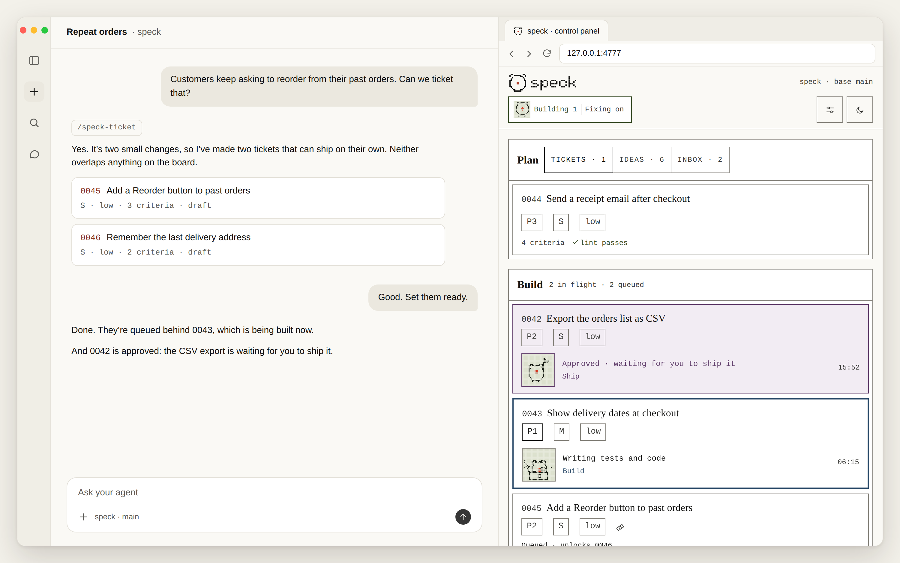

# speck

**Ship code you can't read, and still trust it.**

speck turns ideas from a conversation into tickets, then builds, tests, reviews and ships them the same way every time.

speck was built by a product manager, for people who work in and around engineering teams but don't write code: product managers, founders, programme managers and designers. They've always had to ship code they can't read. It's for engineers too.

You plan tickets in a conversation with your coding agent and follow the builds in speck's panel. Both sit side by side in one app, such as Claude Code's desktop app, Cursor or an editor with a built-in browser.

You make two decisions: what gets built and what gets shipped. When your tickets look right, set them ready, start the builds from the panel and walk away. Go to a meeting, have lunch, go to bed. While you're gone, speck works through them and stops only when it needs you. Nothing ships until you ship it, unless you've told speck it can ship low-risk tickets on its own.

You can trust the result without reading the code because every ticket goes through the same steps. Its tests are written first, from acceptance criteria you agreed up front. The agent that builds it checks its own work, a second AI reviews it independently, and the whole test suite runs before it ships. Each approved ticket comes with a one-page review pack in plain English, with the reviewer's evidence for every criterion.

<picture>
  <source media="(prefers-color-scheme: dark)" srcset="docs/images/demo-dark.png">
  
</picture>

> Status: 0.6.0, a public preview. It works end to end on a local machine. Expect rough edges.

## Get started

Paste this prompt into your coding agent, opened in the folder of the project you want to build, or in an empty folder for a new one. [Claude Code](https://claude.com/claude-code) is the agent speck is most tested with.

```text
Set up speck in this folder. If Node.js 20 or newer isn't installed, offer to
install it first. Then run `npx 'github:luroai/speck#semver:*' init` and
follow the speck-setup skill it installs. Ask me before changing anything on
my machine or in git.
```

Your agent checks what's there, explains each choice in plain words and waits for your answer before it installs anything, makes a commit or changes a setting. When it's done, speck is ready to build your first ticket.

## How it works

speck takes every change from an idea to shipped code in the same steps, and waits for you at two of them.

If you can write a good ticket, you can ship.

```
idea → ticket → [you: ready] → agent builds → second agent reviews, turn by turn → approved → [you: ship, or auto-ship]
```

Every change is a small numbered ticket in your repo, sized for one agent in one sitting. In the commands below, `speck` stands for `node .speck/scripts/speck.mjs`, which `init` puts in your project.

### Your first decision: what gets built

Talk ideas through with your agent. It writes them up as small tickets, each with a short list of what done looks like.

`/speck-capture` saves an idea, or the whole conversation, to `speck/ideas/`. `/speck-ticket` turns it into numbered draft tickets in `speck/tickets/`, each with a problem, an outcome and its acceptance criteria. Your agent checks each one against the size rules in `speck/config.yml` (`limits.max_acceptance_criteria`, `limits.max_changed_lines`), for overlap with what's already there and for criteria that could be read two ways. speck makes you split anything bigger: a ticket of size `L` can never be ready.

Read a draft, then set it ready with Set ready in `speck panel`, or with `speck set <id> status ready`. That's Gate 1. Setting it ready lints the ticket and commits it on the base branch, and only then can a build pick it up. A ticket can wait on others with `after:` in its frontmatter, and starts only once they've shipped.

### Everything in between

speck builds each ticket tests first, checks its own work, then has a second AI review it. Each ticket is built in its own git worktree, and no agent ever approves its own work.

`speck run` watches for ready tickets and starts `/speck-build <id>` for each, highest priority first, using `build_command` in `speck/config.yml`. It builds one at a time unless you raise `max_parallel_builds`. You can also start a build yourself with `/speck-build <id>`.

A build runs `speck start <id>`, which makes the ticket's branch in its own git worktree beside your checkout (with `worktrees: true`) and sets it to `building`. It writes a test for each acceptance criterion and checks that the tests fail, then writes the simplest code that makes them pass. A criterion about how a document reads ends with "(checked by review)" and gets no test: the reviewer checks it by reading the document. A build runs the ticket's own tests; the whole suite runs when a ticket ships. If the change goes over `limits.max_changed_lines`, it stops and proposes a split rather than pushing on. Before the first review round it runs a self-check, going over its change the way an adversarial reviewer would: unusual input, stale state, error paths, claims in docs and scope.

Then `/speck-review` starts the review loop. The builder (Claude Code by default, set as `builder`) hands the ticket, the diff and the test output to an independent reviewer (Codex by default, set as `reviewer`), which runs read-only. They take turns until the reviewer approves or a question comes back to you. When it approves, the ticket is `approved` and waits on its branch.

### Your second decision: what ships

Read a one-page review pack, then ship. Or let low-risk work ship itself.

Every approved ticket has a review pack (`speck pack <id>`, or the ticket in the panel), written for someone who doesn't read code. Read it, then run `/speck-ship <id>` or click the Ship button in the review pack. That's Gate 2. Agents never merge or ship unless you do one of those, or you turn on `auto_ship` in `speck/config.yml`. With `auto_ship` on, `speck run` ships each approved ticket whose risk is listed in `auto_ship_risk` (`[low]` by default) as soon as the reviewer approves it, while it's on.

Shipping runs `speck ship <id>`. It refuses, changing nothing, unless the reviewer approved the ticket, nothing outside `speck/` changed after that approval, the working tree is clean and the whole test suite passes on the ticket merged with the base branch as it is now. Then it sets the ticket to `done`, merges the branch into `main`, pushes it if you have a remote, and deletes the branch. No GitHub needed. Everything happens in your local repo.

## What a review pack looks like

A review pack is the one page you read before you decide whether to ship a ticket.

Every approved ticket has a **review pack** written for someone who doesn't read code:
- each acceptance criterion with ✅/❌ and the reviewer's evidence;
- a plain-English summary;
- risk flags (sensitive files touched, size);
- the review history;
- actuals: review rounds, reviewer tokens and elapsed time.

## The clever bits

These are the jobs speck takes off your hands, from raising its own fix tickets to keeping the receipts.

**It raises its own fix tickets.** If `main` breaks, the build that finds it writes a priority-0 fix ticket and sends it to the front of the queue, instead of patching it inside someone else's work. When `speck ship` finds the base branch's own tests failing, the build creates the ticket with `speck new "<title>" --type=fix`, which sets priority 0, and runs `speck set <fix-id> status ready`, unless an open fix ticket already covers the failure. Its own ticket stays `approved`, and the ship queue tries it again once the fix has shipped.

**It files its own follow-ups.** A build that spots a bug or a better idea saves it to your inbox, after checking it isn't there already. Each is a note in `speck/ideas/` with `Status: inbox` and the ticket it came from, checked first against every idea and ticket, open or done. `/speck-ticket` triages the inbox down to at most three decisions.

**Ideas only become tickets in conversation.** Say "capture this" and your agent saves the idea, or the whole conversation, in your repo with `/speck-capture`. It becomes tickets only when you talk it through with your agent, through `/speck-ticket`, which writes each one as a `draft`. The panel shows your ideas but has no button that turns one into a ticket.

**It asks, then moves on.** When a build needs your call, it stops with one plain question, the options and its recommendation. It writes the question under `## Blocked question` in the ticket and sets it to `blocked`, and `speck run` carries on with the next ticket. Answer it, then run `/speck-build <id>` to resume it; the panel shows the command that reopens the build's own session (`resume_command`).

**It sorts out its own merge conflicts.** When `main` has moved on, the build merges it in, keeps what both sides meant and has the merge reviewed again before it ships. When a ship from the queue hits a conflict, `speck run` hands the ticket back to its build's session. `speck merge-check <id>` sorts each conflicting file into a class (`added-lines`, `lockfile`, `ticket` or `logic`), the build resolves each by its class, and the reviewer checks the merge in a merge round. Merge rounds have their own limit, `max_merge_rounds`. After two hand-backs without a ship, the build blocks the ticket with a question instead.

**It fits in your pocket.** Put the panel behind a private tunnel and add it to your phone's home screen. It opens as an app, so you can set tickets ready and ship from anywhere. Start it with `speck panel --url https://<hostname>`, the address your tunnel gives it (see [The panel](#the-panel)).

**It keeps the receipts.** Every ticket keeps how long it took and how many review rounds it needed, and the panel shows what builds cost. Each round's full record is saved in the ticket's `## Review rounds`, and approval adds the review rounds, reviewer, reviewer tokens, elapsed time and changed lines to its `## Delivery log`. Builds that `speck run` starts also record the builder's tokens and cost. The code, the tickets and the tests say what the product does, so there's no separate spec to keep up to date.

## Under the hood

These sections explain how speck works inside: the review loop, where it keeps its state, which tests run when, and how builds and ships are queued.

[`docs/brief.md`](docs/brief.md) has the full design.

### The review loop

The builder owns the loop. It starts the reviewer with the ticket, the diff against the base branch and a summary of the test output. The reviewer returns a structured verdict: a `pass`, `fail` or `unclear` for each acceptance criterion with its evidence, findings marked `blocking` or `minor`, and `approve`, `changes_requested` or `escalate`. The builder answers each blocking finding as `fixed`, `disputed` with a reason, or `needs_pm` for a question only you can answer. The next round resumes the same reviewer session (for Codex, `codex exec resume`), so the reviewer remembers its earlier findings and re-checks each fix and dispute.

The loop ends when the reviewer approves with no blocking findings and every criterion passing. It blocks the ticket with one question for you after `max_review_rounds`, default 3, unless the last round left no more than one blocking finding open, which earns one extra round. It escalates to you sooner when the same finding is disputed in two consecutive rounds (`escalate_after_repeat_disputes`), when the reviewer escalates, or on `needs_pm`. Minor findings never block: they go into the ticket's Delivery log, and those worth a ticket into your inbox. A reviewer from the builder's own family, such as `claude` or `claude-subagent` reviewing a Claude build, is allowed only when `builder_model` and the reviewer's model are both set and differ, unless you set `allow_same_model_review: true`.

### Where state lives

The tickets, the reviews and every decision stay in your repo, as Markdown and YAML. A ticket's status, priority, size, risk, builder, reviewer and `after:` list are in its frontmatter. Each review round is a collapsed block in the ticket's `## Review rounds`, which only speck writes, with a one-line summary in its `## Review log`. Its `## Delivery log` keeps the actuals and follow-ups. Shipped and cancelled tickets move to `speck/tickets/done/`, keeping all of it. `speck/.cache/`, which git ignores, holds working files for reviews in progress, recorded test results, `speck run`'s logs, the record of flaky tests and this machine's own settings, in `speck/.cache/machine/config.yml`.

### Which tests run when

A build never runs the whole suite. Before it changes anything, it reads the result recorded for the same code with `speck test --recorded` and writes the tests already failing as `Failing before this build:` in the ticket's Notes. After that it runs only test files, with `speck test --files <file>…`: the ticket's own while it builds, and before every review round the ticket's own, any existing ones it changed and those of any test that failed last time. Every such run also runs the project's quick checks of rules for the whole repo, the test files listed in `commands.checks`. The reviewer sees a summary of that run. The whole suite runs in `speck ship`, on the ticket merged with the base branch, which is what lands. A full run on code that hasn't changed reuses the recorded result, and a test that fails in a full run then passes on a second try is logged as flaky.

### Builds and the ship queue

`speck run` keeps up to `max_parallel_builds` builds going, 1 unless you raise it for the project or for this machine, each on its own branch in its own worktree, so a build never touches your checkout and you keep writing ideas and tickets on the base branch. Builds end at `approved`. One ship queue in `speck run` ships approved tickets one at a time, so ships never race each other for `main`, and each ship tests the ticket as it would land on the base branch as it is then. If that fails, the queue hands the ticket back to its build: to merge `main` in, to fix tests that fail with `main`'s newer changes, or to raise a fix ticket when `main`'s own tests fail. While the queue is paused because `main`'s own tests fail, it still ships approved fix tickets. When `main` on your remote has moved on while yours has commits of its own, `speck ship` merges the remote's in first, or stops, changing nothing, when it can't do that cleanly. A build that was killed before it finished is resumed once. `speck pause <id>`, `speck play <id>` and `speck stop <id>` hold, carry on or end a build.

## Who it's for

speck is for people who decide what gets built and don't want to read every line of code, and for engineers who want a light review loop.

Most AI coding tools sell speed or autonomy. speck gives you the speed and keeps the judgement with you: what's worth building, what "done" means and whether it's good enough to ship.

You think in outcomes, not diffs. You're a PM, a founder, or the person on the team who always has the spec. You have more ideas than evenings, a coding agent you already trust with real work, and no wish to read every line it writes. You set speck up by talking to your agent, write tickets, set them ready and walk away.

It's also for engineers who want a light, auditable loop: ticket, build, independent review, merge. It's not for large multi-team specs, or work that needs design documents spanning many changes.

Inspired by [OpenSpec](https://github.com/Fission-AI/OpenSpec), with less ceremony.

## The panel

The panel shows your tickets, builds and shipped work in your browser, and lets you set tickets ready and ship them from there.

`node .speck/scripts/speck.mjs panel` opens a control panel in your browser, at `http://127.0.0.1:4777`. It runs on your machine and reads the files in your repo.

- **Plan:** your draft tickets, ideas and inbox, in full. Set a draft ready or change its priority with a click.
- **Build:** the queue, with each build's log as it runs. Turn `speck run` on or off from the header. Stop a build, see which builds are paused (`speck pause <id>` and `speck play <id>` hold and carry them on), and see blocked tickets with their questions and how to resume them. Read an approved ticket's review pack, and ship it from there with its Ship button, which asks first and does what `/speck-ship` does. A ticket being shipped says "Shipping" once, beside its builder, with how long the ship has been running, whoever started it, and an auto-ship that didn't finish says so.
- **Settings:** the settings people tune, from the Settings button in the header, each with its value and an explanation. Change them and save them all with one button. A change that lets more tickets ship without you asks first, naming them, and `max_parallel_builds` and `max_parallel_tests` can be saved for this machine only.
- **Shipped:** what's shipped and when, with the median time, review rounds and tokens per ticket, for the reviewer and the builder.

To use the panel from your phone, put it behind a private tunnel that makes you log in, such as `tailscale serve` or Cloudflare Tunnel with Cloudflare Access, and start it with that address: `node .speck/scripts/speck.mjs panel --url https://<hostname>`. The panel then also serves that one address and accepts its button presses. Add it to your phone's home screen to open it full screen as an app called speck, with speck's logo as its icon. Never expose it openly: anyone who can load the page can start builds and ship.

## Requirements

speck needs the following on your machine.

- macOS or Linux
- [Claude Code](https://claude.com/claude-code), or another builder: any coding agent that reads skills from `.agents/skills/` or `.claude/skills/`, such as [Codex](https://github.com/openai/codex) or [Cursor](https://cursor.com/docs/cli/installation). Set it as `builder:` in `speck/config.yml`, so `speck doctor` checks the right tool. Claude Code is the default and the one most tested.
- git
- Node.js 20 or newer, which your agent can install for you
- Optional: [Codex CLI](https://github.com/openai/codex) as the reviewer (the default). Otherwise [Claude Code](https://claude.com/claude-code) (`reviewer: claude`), any agent with a non-interactive mode set up as a reviewer command in config (see below), or a Claude subagent reviewer if you allow it

Not yet: Windows (speck says so and suggests WSL), Jira or GitHub Issues sync, pull requests as the way to ship, and hosted or cloud builds.

## Without an agent

You can install speck yourself, without an agent, with one command.

Run this in the folder of the project you want to build:

```bash
npx 'github:luroai/speck#semver:*' init
```

This one command:
- sets up `speck/` (config, ideas and tickets);
- adds the speck skills to `.claude/skills/` and `.agents/skills/`, so Claude Code, Codex, cptr and other agents all find them;
- puts the `speck` command in `.speck/`;
- checks that git, your builder and your reviewer are installed and signed in, and tells you in plain English how to fix anything that isn't.

Commit the new files, and everyone working on the repo gets speck too. To update speck, run the same command again. It refreshes the skills and keeps your config and tickets.

To re-check your setup at any time: `node .speck/scripts/speck.mjs doctor`.

## Commands

These tables list speck's commands: the skills you run in your agent, and the commands you run in your terminal.

In your agent:

| Skill | What it does |
|---|---|
| `/speck-setup` | Takes you through setting speck up in a conversation: checks what's there, explains each choice (base branch, test command, builder and reviewer, whether `speck run` builds skip permission prompts), goes through the settings in the panel's Settings view, such as `auto_ship` and the ticket size limits, asks before changing anything, and finishes once `speck doctor` passes. It's hidden from the `/` menu: the setup prompt above starts it |
| `/speck-capture` | Saves an idea or the current conversation to `speck/ideas/` |
| `/speck-ticket` | Turns an idea into small, numbered draft tickets that pass the size rules, or triages the inbox down to at most three decisions |
| `/speck-build <id>` | Builds one ready ticket: tests from the acceptance criteria, then code, then the review loop. Ends with the ticket `approved`, for `speck run` to ship if `auto_ship` allows it |
| `/speck-ship <id>` | Ships an approved ticket (Gate 2): final checks and tests, then merges into `main`, pushes and deletes the branch. Only you run this, or click the Ship button in the ticket's review pack in the panel |
| `/speck-status` | Tickets by status: approved (waiting for you) first, then blocked questions |
| `/speck-review <id>` | Re-runs the review loop on its own |

In your terminal, as `node .speck/scripts/speck.mjs <command>` (`speck help` lists them all):

| Command | What it does |
|---|---|
| `set <id> status ready` | Approves a ticket for building: `node .speck/scripts/speck.mjs set <id> status ready` (Gate 1). Run it on the base branch: it commits the ticket, and only that file. `set` also changes a ticket's priority, size, title and other fields |
| `run` | Starts `/speck-build` in a non-interactive session for each ticket once it's committed as ready on the base branch, one at a time unless you raise `max_parallel_builds`, using `build_command` in `speck/config.yml`. The default skips all permission prompts. A build that was killed before it finished is resumed once |
| `panel` | The control panel in your browser |
| `pause <id>` / `play <id>` / `stop <id>` | Hold a running build where it is, carry it on, or end it and block its ticket, keeping its branch and work if it had started. A ticket stopped before its build started is built again with `/speck-build <id>` |
| `status` | Tickets by status, blocked first (`--json` for programs) |
| `pack <id>` | The review pack for a ticket |
| `cancel <id> "<reason>"` | Cancels a ticket you've decided against, keeping the reason |
| `config set <key> <value>` | Changes one setting in `speck/config.yml`, checking it first. `config set --machine <key> <value>` sets `max_parallel_builds` or `max_parallel_tests` for this machine only |
| `config show` | The main settings by group, with each one's value, whether it's the default and what it does |
| `doctor` | Checks that git, your builder and your reviewer are ready |

## Using another reviewer

Any agent that can run non-interactively can review. Give it a name and a command in `speck/config.yml`, and `speck review` runs it and records its verdict:

```yaml
reviewer: cursor
reviewer_options:
  cursor:
    command: "cursor-agent -p --output-format json --mode ask --model {model}"
```

To let later rounds continue the reviewer's own session instead of resending everything, add `session_id_path` (where the session id is in its output) and a `resume_command` with `{session}`. `{model}` and `{effort}` come from `reviewer_model` and `reviewer_effort`; if one is blank, it's left out with its flag. The reviewer is asked to stay read-only, but speck doesn't sandbox it, so use the tool's read-only mode. Flags change, so check your tool's current ones.

Claude Code needs no command: set `reviewer: claude` and speck runs it for you, whatever the builder, so a Codex or Cursor build can be reviewed by Claude. It runs without a person in Claude Code's `dontAsk` permission mode, which runs read-only commands and denies anything else rather than asking, with its file-writing tools taken away, and later rounds resume the same session. Allow rules in your project's own Claude Code settings still apply. Set `allow_same_model_review: true` if Claude is also the builder, unless `builder_model` and `reviewer_model` are both set and differ.

## Repo layout

This is where speck keeps its files in your repo.

```
.claude/skills/speck-*/      # the skills, for Claude Code (installed by init)
.agents/skills/speck-*/      # the same skills, for Codex, cptr and other agents
.speck/                      # the speck command and templates (installed by init)
speck/
  config.yml                 # builder, reviewer, test command, limits
  ideas/                     # captured ideas, and the inbox of follow-ups from builds
  tickets/0007-<slug>.md     # numbered tickets; status in frontmatter, every review round at the end
  tickets/done/              # shipped and cancelled tickets
```

## Built with speck

speck is built with speck. Since 8 October 2026, its features have gone through its own tickets, builds and independent reviews:

- **265 tickets shipped** and 16 cancelled, each with its review rounds and delivery log in [`speck/tickets/done/`](speck/tickets/done/).
- **13 minutes** median from a build starting to its ticket shipping.
- **1 review round** median. 136 tickets were approved in the first round.

That's why the commit history is long: each ticket leaves a trail of small, automatic commits as it moves from ready to shipped. The count isn't the point. Behind every ticket is a decision about what to build, and another about whether it was good enough to ship. In practice the agents keep up with you, not the other way round: by the time you've written the next ticket, the last one has often shipped.

## Design

See [`docs/brief.md`](docs/brief.md) for the principles, the workflow, the size rules and the review loop in full.

## Licence

speck is free to use, change and share under the MIT licence. See [LICENSE](LICENSE).
