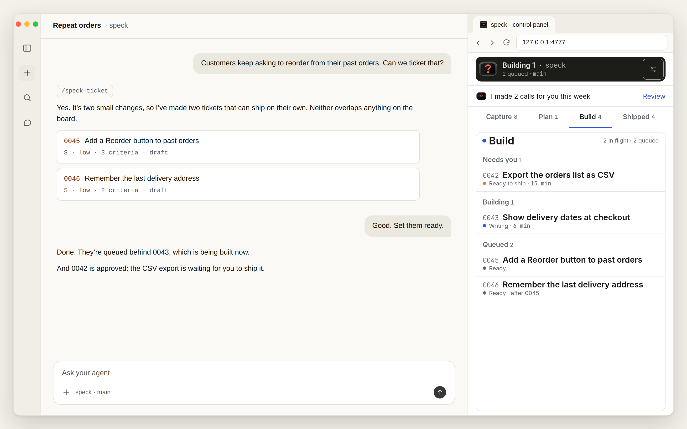

# speck

**Plan in ten minutes. Come back to it shipped.**

speck is your engineering manager. You decide what gets built and what done looks like, in a quick conversation with your own coding agent. Then you walk away, and getting it shipped is speck's job. It runs the builder and reviewer you chose: the builder writes each change tests first and a second AI reviews it, the same way every time. When a build needs a call, speck makes the obvious ones itself. When work gets stuck, it looks into why and gets it moving. Then it tells you what it did and why, and asks you only when there's no clear answer. Give it a name of your own, and it goes by that.

speck isn't only for code. A ticket can be a task instead, such as drafting an email, writing a plan or pulling together research. speck has your agent do it, a second AI checks it against what you asked for, and the result waits for you in `outputs/`.

speck was built by a product manager, for product managers and anyone who has spent years working alongside tech teams without writing the code themselves. You already know how to shape a piece of work and tell when it's done. speck fits the way that work really happens, in bursts between everything else: ticket up a batch before a meeting, come back afterwards to see what's shipped, and set the next batch going before you log off. speck interrupts you only for a call that's really yours, with one plain question and its recommendation. Engineers use speck too.

You don't need to read the code to check the work. Every ticket comes with a one-page review pack in plain English, with the reviewer's evidence for each criterion. Ship the first few yourself from their review packs. Once you're confident, turn on auto-ship, and speck ships approved work while you're away.

<picture>
  <source media="(prefers-color-scheme: dark)" srcset="docs/images/demo-dark.png">
  
</picture>

Use the agents you already have: Claude Code, Codex or Cursor, or a model provider you have an API key for, such as DeepSeek. speck doesn't let a model review its own work unless you allow it.

> Status: 1.1.0. It works end to end on your own machine.

## Get started

Paste this prompt into your coding agent, opened in the folder of the project you want to build, or in an empty folder for a new one. [Claude Code](https://claude.com/claude-code) is the best builder in testing so far.

```text
Set up speck in this folder. If Node.js 20 or newer isn't installed, offer to
install it first. Then run `npx 'github:luroai/speck#semver:*' init` and
follow the speck-setup skill it installs. Ask me before changing anything on
my machine or in git.
```

Your agent checks what's there, explains each choice in plain words and waits for your answer before it installs anything, makes a commit or changes a setting. When it's done, speck is ready to build your first ticket.

## How it works

You make one decision: what gets built. speck manages everything after it, in the same steps every time, and ships by itself once you trust it to. Every change is a small numbered ticket in your repo, sized for one agent in one sitting. If you can write a good ticket, you can ship.

```
idea → ticket → [you: ready] → builder builds → reviewer reviews, turn by turn → approved → shipped (by you, then by auto-ship)
```

### Your decision: what gets built

Talk ideas through with your agent. `/speck-capture` saves an idea to `speck/ideas/`, and `/speck-ticket` turns it into small draft tickets in `speck/tickets/`, each with a problem, an outcome and a short list of what done looks like. Read a draft, then set it ready in the panel, or with `speck set <id> status ready`. That's Gate 1: only a ready ticket gets built.

### Everything in between: speck's job

`speck run` starts a build for each ready ticket, each in its own git worktree, so your checkout stays yours. The builder writes a test for each acceptance criterion, then the code, then checks its own work. A second AI reviews it, and they take turns until the reviewer approves. No agent ever approves its own work.

When a build hits a question it can't answer from the ticket, it stops with one plain question, the options and the one it recommends. Once you let it (see below), speck takes that recommendation itself on a low-risk ticket, resumes the build and adds the call to **Decided for you**, its report in the panel, with the options it didn't choose. Change any you'd have called differently. It leaves the question for you when the build has no recommendation, when the ticket is high risk, or once it has taken three calls on the same ticket.

speck also keeps work moving. Once it's on, when a build or a ship stops for a reason it has no steps for, or a build runs far longer than usual, it has its own agent look into it and do one thing about it: resume the build with an instruction, try the ship again, raise a fix ticket, tell you what it found or ask you.

Some questions need someone to look at the app itself, such as how a page looks or whether signing in works. Once it's on, speck checks those on a low-risk ticket itself: it starts your app from that ticket's copy of the code, signs in with a test login you've saved on your machine if it needs to, takes screenshots, then carries on or asks you, saying what it saw. The screenshots show in the ticket's review pack. You don't have to tell speck how to start your app first: the first time it needs to, it works out how from your project, tries it and remembers what worked. If nothing works, it asks you.

Usage limits don't stop the line either. When Claude, Codex or Cursor runs out of usage partway through a build, or Claude or Codex partway through a review, speck waits for the limit to reset and carries the build on by itself, without you answering anything. If speck's own agent runs on Claude and hits the limit, speck looks into stopped work on another of your agents, such as Codex, and moves back once the limit resets.

### Turning it on

speck takes the obvious calls once you choose `decide` for `watch`, in the Your engineering manager group of the panel's Settings, or with `speck config set watch decide`. Until then `watch` is `tell`, and every question waits for you. `fix` sits between the two: speck takes only clear-cut calls that change nothing you'd notice, and looks into stops and long builds.

To give it a name of your own, set `speck_name` in the same group, or run `speck config set speck_name "<name>"`. Wherever it speaks or acts for you, in the panel, `speck status` and `speck run`'s log, it then goes by that name.

### Shipping: yours, until you trust it

Every approved ticket has a one-page **review pack**, written for someone who doesn't read code: each acceptance criterion with ✅/❌ and the reviewer's evidence, a plain-English summary, risk flags, the review history and what it took. Start by reading it and shipping by hand, with the Ship button in the panel or `/speck-ship <id>`. That's Gate 2.

Once you trust the work, turn on auto-ship, in the panel's Settings or with `speck config set auto_ship true`, and `speck run` ships each approved ticket one at a time, while you're away. Auto-ship stays off until you turn it on, and even then some tickets wait for you at Ship:

- a high-risk ticket, unless you add high to `auto_ship_risk`
- a ticket whose acceptance criteria changed after you set it ready, with its review pack showing what changed
- a task, as reading its result is its review
- a ticket whose approving review speck didn't run itself, or whose review record has changed since, so only a review speck saw for itself can ship work unseen

The review pack is still there whenever you want to check the work.

## The clever bits

- **speck makes the obvious calls, and tells you.** With `watch: decide`, speck takes a build's recommendation on a low-risk ticket instead of stopping the line, and lists each call in Decided for you with what it didn't choose.
- **speck looks into stops and slow builds.** When a build or a ship stops for a reason speck doesn't expect, or a build runs well past its usual time, speck has its own agent look into it and do one thing about it, or ask you.
- **speck checks the running app itself.** When a build asks how something looks or works, speck starts your app, signs in with your test logins and looks, and keeps the screenshots in the review pack.
- **speck waits out usage limits.** When Claude, Codex or Cursor hits its usage limit, speck picks the work up again once it resets, so a limit overnight doesn't leave the queue stuck until morning.
- **speck holds back a ticket whose criteria changed.** If a ticket's acceptance criteria changed after you set it ready, it never ships by itself: it waits for you at Ship, showing what each criterion was and is now.
- **speck raises its own fix tickets.** If `main` breaks, speck has the build that finds it write a priority-0 fix ticket and send it to the front of the queue, instead of patching it inside someone else's work.
- **speck sorts out its own merge conflicts.** When `main` has moved on, speck has the build merge it in, keep what both sides meant and have the merge reviewed again.
- **speck files its own follow-ups.** When a build spots a bug or a better idea, speck has it save the idea to your inbox, after checking it isn't there already.
- **Ideas only become tickets in conversation.** Your agent saves an idea when you ask it to, and turns it into tickets only when you talk it through.
- **speck shows where everything stands at a glance.** The panel's black bar says what speck is doing in a word or two, such as Building, Shipping or Needs you.
- **speck fits in your pocket.** Put the panel behind a private tunnel and add it to your phone's home screen (see [The panel](#the-panel)).
- **speck keeps the receipts.** Every ticket keeps its review rounds, how long it took and what it cost, and the tickets and tests say what the product does, so there's no separate spec to keep up to date.

## Under the hood

The tickets, the reviews and every decision stay in your repo, as Markdown and YAML. `speck/config.yml` holds the project's settings, and your own choices, such as who builds and reviews, can be kept for this machine only.

**Your agents.** speck builds and reviews with the agents you've set up: Claude Code, Codex, Cursor, or a model provider such as DeepSeek through your own API key. Add them, and pick each role's agent and model, in the panel's Settings. API keys stay on this machine, out of git, and so do the test logins speck signs in to your app with, which you save with `speck logins set <name>`.

**Your app.** To check a question in your app, speck starts it with `commands.start`, a command with `{port}` where the port goes. Leave it blank and speck works it out the first time it needs it, then saves it. `speck app <id>` starts the app from a ticket's copy of the code for you to look at, and `speck app <id> --stop` stops it.

**Which to choose.** speck works with one agent building and reviewing (set `allow_same_model_review: true`), but two different agents are best: a second model reviews adversarially and catches what the builder misses. The best options from testing so far:

- **Builder: Claude Code.** Claude Code builds speck itself.
- **Reviewer: Codex, with gpt-6.1-sol.** Codex has reviewed almost every speck ticket, usually in under a minute a round.
- **Grok through Cursor** worked well as a builder in a short test, but is slow as a reviewer: it found the same problems as Codex but took 4 to 11 minutes a round.

A build runs only the tests its change touches. The tests in `commands.test` run when a ticket ships, on the ticket merged with `main` as it is then, and one ship queue ships approved tickets one at a time, so ships never race each other. If your whole suite is slow, make `commands.test` the quick tests and set `commands.test_full` to the whole suite: ships then wait only for the quick tests, and `speck run` runs the whole suite on `main` after ships, without holding anything up. If it fails, speck counts it under Needs you, and `speck status` names the failing tests. [`docs/brief.md`](docs/brief.md) has the full design.

## Who it's for

Most AI coding tools sell speed or autonomy. speck gives you both, and keeps the judgement that matters with you: what's worth building and what "done" means. A second AI checks every change against it, so you can ship by hand while you build trust, then let speck ship while you get on with something else.

Inspired by [OpenSpec](https://github.com/Fission-AI/OpenSpec), with less ceremony.

## The panel

The panel is a phone-width column you keep beside your agent, or open on your phone. Start it with `node .speck/scripts/speck.mjs panel`, at `http://127.0.0.1:4777`. The panel runs on your machine and reads the files in your repo.

- **The black bar**, at the top, shows speck and what's happening: Building, Shipping, Idle, or Needs you when a ticket is waiting on you. Press it for the Pipeline log, which you can filter to decisions, ships or builds.
- **Capture, Plan, Build and Shipped** are tabs you press or swipe between, each a list of compact rows. Capture lists your ideas and inbox notes to read. Plan has your draft tickets. Build groups the queue under Needs you, Building and Queued. Shipped opens with three figures, then what's shipped and what it took.
- **A ticket's full view** opens when you press its row in Build or Shipped: how far it has got, what it should do, its log, any question for you, its review pack, and its Ship button once it's approved.
- **Decided for you**, from a line under the bar, is speck's report of the calls it made for you this week, with what it didn't choose. Change any you'd have called differently.
- **All projects** appears in the project menu, on the project's name in the bar, once two or more projects' panels are running. It opens the bridge: what needs you and how each project is doing, across all of them.
- **Settings**, from the button in the bar, turns `speck run` on and off, picks your builder and reviewer, and holds the settings people tune.

To use it from your phone, put it behind a private tunnel that makes you log in, such as `tailscale serve` or Cloudflare Tunnel with Cloudflare Access, and start it with `node .speck/scripts/speck.mjs panel --url https://<hostname>`. Add it to your home screen to open it as an app. Never expose it openly: anyone who can load the page can start builds and ship.

## Requirements

- macOS or Linux, git, and Node.js 20 or newer, which your agent can install for you
- [Claude Code](https://claude.com/claude-code) as the builder (the default), or another agent such as [Codex](https://github.com/openai/codex) or [Cursor](https://cursor.com/docs/cli/installation)
- Optional: [Codex CLI](https://github.com/openai/codex) as the reviewer (the default). Otherwise Claude Code, Cursor, a model provider or any agent with a non-interactive mode (see below)
- Not yet: Windows (speck says so and suggests WSL), Jira or GitHub Issues sync, and hosted or cloud builds

## Without an agent

Run this in the folder of the project you want to build. The `init` command sets up `speck/`, adds the skills for Claude Code, Codex and other agents, and checks that git, your builder and your reviewer are ready:

```bash
npx 'github:luroai/speck#semver:*' init
```

Commit the new files, and everyone working on the repo gets speck too. Run the same command again to update speck, or `node .speck/scripts/speck.mjs doctor` to re-check your setup.

## Commands

In your agent, `/speck-capture`, `/speck-ticket`, `/speck-build <id>` and `/speck-ship <id>` take a change from idea to shipped, and `/speck-status` shows where everything stands. Only you run `/speck-ship`.

In your terminal, `speck` stands for `node .speck/scripts/speck.mjs`, which `init` puts in your project. `speck help` lists every command:

| Command | What it does |
|---|---|
| `check <id>` | The ready check: whether a ticket is ready to build, and what stops it |
| `set <id> status ready` | Approves a ticket for building (Gate 1). `set` also changes its priority, size and other fields |
| `run` | Builds each ready ticket, and ships approved ones `auto_ship` covers |
| `panel` | The control panel in your browser |
| `pause <id>` / `play <id>` / `stop <id>` | Hold a running build, carry it on, or end it and block its ticket |
| `status` | Tickets by status, blocked first (`--json` for programs) |
| `pack <id>` | The review pack for a ticket |
| `cancel <id> "<reason>"` | Cancels a ticket you've decided against, keeping the reason |
| `config set <key> <value>` | Changes one setting. Your own are saved for this machine only, the rest in `speck/config.yml` |
| `config show` | The main settings by group, with each one's value and what it does |
| `keys` | Model providers' API keys on this machine: `keys set <provider>` and `keys remove <provider>` |
| `logins` | Test logins on this machine, for speck to sign in to your app: `logins set <name>` and `logins remove <name>` |
| `app <id>` | Starts your app from a ticket's copy of the code and prints its address (`--stop` stops it) |
| `agents` | The agents speck knows, and which are yours: `agents add <agent>` and `agents remove <agent>` |
| `doctor` | Checks that git, your builder and your reviewer are ready |

## Using another reviewer

Claude Code, Cursor and model providers such as DeepSeek need no setup: set `reviewer: claude`, `reviewer: cursor` or `reviewer: deepseek` and speck runs them read-only. Any other agent that can run non-interactively can review too, with a name and a command under `reviewer_options` in `speck/config.yml`, as [the brief](docs/brief.md) shows.

## Built with speck

speck is built with speck. Since 8 October 2026, its features have gone through its own tickets, builds and independent reviews:

- **623 tickets shipped** and 16 cancelled, each with its review rounds and delivery log in [`speck/tickets/done/`](speck/tickets/done/).
- **14 minutes** median from a build starting to its ticket shipping, leaving out time it waited for you or the machine was asleep.
- **2 review rounds** median. 303 tickets were approved in the first round.

That's why the commit history is long: each ticket leaves a trail of small, automatic commits as it moves from ready to shipped. The count isn't the point. Behind every ticket is a decision about what to build, and another about whether it was good enough to ship. In practice the agents keep up with you, not the other way round: by the time you've written the next ticket, the last one has often shipped.

## Design

See [`docs/brief.md`](docs/brief.md) for the principles, the workflow, the size rules and the review loop in full.

## Licence

speck is free to use, change and share under the MIT licence. See [LICENSE](LICENSE).
